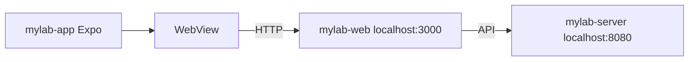

# MyLab WebView 셸 앱 (목표 A, 로컬 URL)

> Expo RN 앱에 `react-native-webview`로 `mylab-web`(로컬)을 전체화면으로 띄우는 셸을 구성하고, 로딩/에러/안드로이드 뒤로가기까지 포함한 MVP를 만든다.

## 플랫폼 호환성

`react-native-webview`는 **Android와 iOS 모두 공식 지원**하며, Expo SDK 54 / Expo Go에서도 사용 가능하다.

| 플랫폼 | 지원 | 비고 |
| ------ | ---- | ---- |
| iOS | O | WKWebView 기반, 스와이프 뒤로가기 제스처 가능 |
| Android | O | 하드웨어 뒤로가기 시 `canGoBack`이면 WebView `goBack()` 처리 필요 |
| Web (브라우저) | 제한적 | 셸 앱 목표와 무관, 우선순위 낮음 |

같은 `WebView` 컴포넌트 코드로 양쪽을 커버하고, 로컬 URL·cleartext·뒤로가기만 플랫폼별로 분기한다.

## 할 일

- [x] `react-native-webview` 설치 (`expo install`)
- [x] 로컬 URL 헬퍼 + Android `cleartextTraffic` 설정
- [x] `App.tsx`를 WebView 셸로 교체 (로딩/에러/뒤로가기/쿠키)
- [ ] `mylab-web`/`mylab-server` 기동 후 시뮬레이터·에뮬레이터에서 로드 검증

## B가 무엇인지 (참고)

목표 A는 **웹을 WebView로만 보여주는 껍데기**이다.  
목표 B는 웹만으로 부족한 기능을 **네이티브가 대신 처리**하는 단계이다. 예:

- 파일/카메라 업로드 (`input[type=file]` 한계 보완)
- 외부 링크를 시스템 브라우저로 열기 (`Linking`)
- 푸시 알림 (`expo-notifications`)
- JS Bridge (`postMessage` ↔ `onMessage`)로 토큰/앱 버전/로그아웃 연동
- 딥링크, 앱 스토어 배포용 네이티브 권한/빌드 설정

지금은 **A만** 진행하고, B는 이후 확장으로 둔다.

## 아키텍처



- 앱은 UI를 거의 그리지 않고 `WebView`만 전체화면으로 렌더
- `mylab-web`이 이미 UA로 모바일 UI를 분기하고 쿠키 로그인을 쓰므로, WebView만으로 로그인/화면 전환이 가능
- 로컬 개발 시 **기기별 호스트**만 다르게 맞춤

## 로컬 URL 규칙

| 실행 환경 | WebView `source.uri` |
| --------- | -------------------- |
| iOS 시뮬레이터 | `http://localhost:3000` |
| Android 에뮬레이터 | `http://10.0.2.2:3000` |
| 실기기 | `http://<맥 LAN IP>:3000` (같은 Wi-Fi) |

구현: `Platform.OS` + `__DEV__`로 기본 호스트를 고르고, 필요 시 `EXPO_PUBLIC_WEB_URL`로 덮어쓰기.

전제:

- `mylab-web` (`yarn dev` → `:3000`)과 `mylab-server` (`:8080`)가 먼저 떠 있어야 함
- Android HTTP 로컬 접속을 위해 `app.json`에 `android.usesCleartextTraffic: true` 추가 (개발용)

## 구현 범위 (A)

1. **의존성**
   - `npx expo install react-native-webview` (Expo SDK 54 호환 버전 고정)

2. **설정**
   - `app.json`: Android cleartext(개발), Safe Area용 `expo-status-bar` 유지
   - 환경 상수: `src/config/webUrl.ts` (또는 루트 `config`)에 로컬 URL 헬퍼

3. **화면**
   - `App.tsx`를 WebView 셸로 교체
   - 필수 props/동작:
     - `source={{ uri: webUrl }}`
     - `style={{ flex: 1 }}` + SafeArea/`StatusBar`
     - `startInLoadingState` + `ActivityIndicator` 로딩 오버레이
     - `onError` / `renderError`로 재시도 UI
     - `allowsBackForwardNavigationGestures` (iOS)
     - Android 하드웨어 뒤로가기: `canGoBack`이면 `goBack()`, 아니면 앱 종료/무시
     - `sharedCookiesEnabled` / `thirdPartyCookiesEnabled` (쿠키 로그인 유지)
     - `javaScriptEnabled`, `domStorageEnabled` true

4. **검증**
   - `yarn start` → iOS/Android에서 로그인·보드 등 모바일 UI 로드 확인
   - 로컬 서버 미기동 시 에러+재시도 노출 확인

## 의도적으로 하지 않는 것 (B 영역)

- JS Bridge, 푸시, 파일 업로드 네이티브 처리
- Expo Router / 다중 네이티브 화면
- 운영/스테이징 URL 전환 UI, EAS Build 배포 파이프라인
- `mylab-web`/`mylab-server` 코드 변경 (요청 범위 밖)

## 핵심 코드 스케치

```tsx
// App.tsx (요지)
<SafeAreaView style={{ flex: 1 }}>
  <WebView
    ref={ref}
    source={{ uri: getLocalWebUrl() }}
    onLoadStart={() => setLoading(true)}
    onLoadEnd={() => setLoading(false)}
    onError={() => setFailed(true)}
    sharedCookiesEnabled
    thirdPartyCookiesEnabled
    javaScriptEnabled
    domStorageEnabled
  />
  {loading && <ActivityIndicator ... />}
</SafeAreaView>
```
